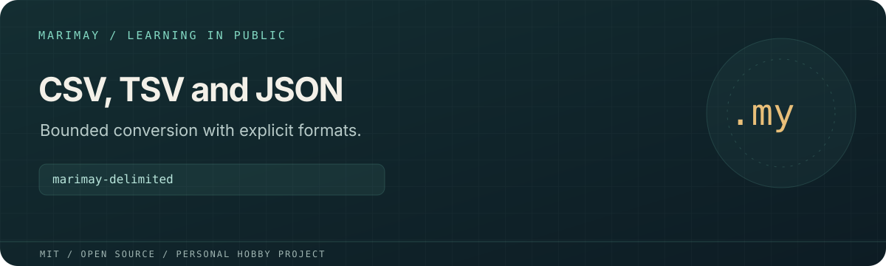

# marimay-delimited



> **Personal learning project.** This open-source MIT project is part of
> [Marimay](https://github.com/marimay-lang/marimay), my hobby programming-language project.
> I maintain it in my spare time to learn by building. APIs and tooling may
> change, and progress may be intermittent.

Converts CSV or quoted TSV to a rectangular JSON table and back. Every field is a string, including headers, numbers and empty values.

**Status:** Experimental Marimay learning application. Process acceptance scripts exercise
VM and native Debug/Release execution. Full platform and performance acceptance
remain in progress; existing reports retain their recorded revisions and limits.

## Run and verify

```sh
mmay run . -- --help
mmay run . -- csv-to-json - < fixtures/sample.csv
mmay run . -- tsv-to-json - < fixtures/sample.tsv
mmay fmt . --check
mmay check .
mmay test . --engine both
MMAY="$(command -v mmay)" python3 tools/acceptance.py
mkdir -p build
mmay build . --release --output build/app
```

Install a compatible `mmay` and use its matching standard library. Application
arguments follow `--` in `mmay run`. Filesystem and environment access requires
explicit grants; native grants are selected at build time.

JSON uses `{"version":1,"rows":[["a","b"],["c","d"]]}`. Both delimited formats
support quoted fields, doubled quotes and embedded line breaks. Output quotes
every field and uses LF record endings. Input/output, rows, columns and fields
have explicit limits. `-` selects stdin/stdout; `--output` atomically replaces
a fully prepared result.

Python generates synthetic inputs and drives independent process checks;
application logic is written in Marimay. `MMAY=/absolute/path/to/mmay` selects
the compiler for Python drivers. `python3 tools/measure.py` runs the existing
measurement harness and writes local reports under `build/`.

See [`BUDGETS.md`](BUDGETS.md), [`ERGONOMICS.md`](ERGONOMICS.md), [`VERIFICATION.md`](VERIFICATION.md) for project-specific budgets,
findings and historical verification details.

## License

[MIT](LICENSE). Existing copyright attribution is retained.
